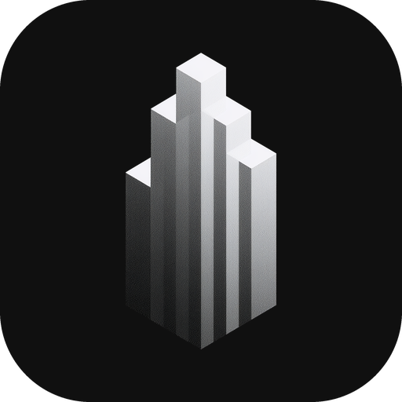

<p align="center">
  
</p>

<h1 align="center">Arcter</h1>

<p align="center">
  Website and trading client for a self-custodial tokenized stock exchange on Solana.<br />
  Marketing pages sit at the root of <a href="https://arcter.xyz">arcter.xyz</a>, and the application lives at <code>/platform</code>.
</p>

## Current status

Arcter is moving to Solana, and this repository is partway through that move.

- Written content (site, app and docs) describes the Solana product.
- The Solana programs in `contracts/` are built and tested but not yet deployed, and the app is not connected to them. Nothing here settles a real trade.
- `src/lib/platform/chain.ts`, `src/lib/platform/env.ts`, `.env.example` and the wallet setup in `PlatformProviders.tsx` still carry the earlier chain wiring and need migrating.

## Tech in use

| Concern | Choice |
| --- | --- |
| Framework | Next.js 16 with the App Router and Turbopack, React 19, TypeScript |
| Styling | Tailwind CSS 4, tokens in `src/app/globals.css` |
| Auth and wallets | Privy |
| Data | Supabase Postgres for profiles, attestations and the venue read model |
| Icons | lucide-react |

## Run it locally

Install Node 24 or newer (the version is pinned in `.nvmrc`), then create a Supabase project and a Privy app.

```bash
npm install
cp .env.example .env.local   # add your Privy and Supabase keys
npm run dev                  # serves on http://localhost:3000
```

Database setup is covered in [`supabase/README.md`](supabase/README.md). Apply `schema.sql` first and `seed.sql` second. A missing variable does not crash `/platform`; the page lists what it needs.

Useful commands:

| Command | Purpose |
| --- | --- |
| `npm run dev` | Local server |
| `npm run build`, `npm start` | Build and serve for production |
| `npm run lint` | ESLint pass |
| `npm run typecheck` | TypeScript pass with no emit |
| `npm run check` | All of the above checks together, for use before a release |

## Public site

`src/app/page.tsx` assembles the sections found in `src/components/home/`:

| Component | Job |
| --- | --- |
| `Hero` | Claim, calls to action, an example ticket and a ticker of planned markets |
| `PricingLedger` | Quote formula as a series of cards |
| `SessionClock` | 24-hour dial tracking the US equity day, regimes and halt rules |
| `VenueLanes` | Vault and maker execution paths |
| `CompareTable` | Arcter set against other ways to trade |
| `ChainBand` | Solana datasheet |
| `PromiseGrid` | Commitments, each paired with a way to check it |
| `Questions`, `Closing` | Accordion of answers, then the closing call to action |

## Application

`src/components/platform/PlatformShell.tsx` provides the sidebar, session status and account controls around six areas:

| Area | Route | Contents |
| --- | --- | --- |
| Overview | `/platform` | Figures, hourly volume, market table and recent fills |
| Trade | `/platform/swap` | The ticket. `?market=AAPLx` preselects a listing. |
| Vaults | `/platform/liquidity` | Vault depth, inventory against target and depositor economics |
| Holdings | `/platform/portfolio` | Fills, attestations and positions, after sign-in |
| Ledger | `/platform/explorer` | Execution against mid, fills, live parameters and governance log |
| Account | `/platform/settings` | Profile and attestations, after sign-in |

### Under the hood

- **Quotes.** `src/lib/platform/markets.ts` is the single home for pricing: guarded mid, tier half-spread times session multiplier, signed skew and a separate fee. Sessions follow the US equity calendar.
- **Data flow.** `useVenue()` in `src/components/platform/usePlatformData.ts` reads the Supabase read model. Empty or unreachable tables trigger a fallback to the built-in catalogue, and pages name the source they show. All current figures are sample data.
- **Public and private reads.** Public content needs no account. Profile and attestation reads are limited to their owner.
- **Writes.** `POST /api/platform/db` receives the Privy access token, verifies it, validates input against `src/lib/platform/ops.ts`, and runs the query with a service-role client. That client sends the user id in an `x-arcter-actor` header, which `app_user_id()` trusts only on service-role requests.
- **Roles.** `TRADER`, `LP`, `MAKER` and `RELAYER` appear under Account. The planned `arcter-access` program will enforce them on Solana.

## Design tokens

Monochrome, taken from the tower mark: a near-black canvas, white as the only accent, and greys that fall away from it. Green and red appear only on values.

- **Color.** Tokens use the `arc-` prefix: `canvas`, `paper`, `sunk` and `hover` for surfaces, `ink` through `ink-4` for text, `line` and `line-strong` for rules, `accent` and its variants, `night` for high-contrast bands, and `up`, `down` and `warn` for values.
- **Fonts.** Geist for all text, Geist Mono for figures, labels and technical strings.
- **Shared parts.** `src/components/platform/ui.tsx` exports Sheet, PageHead, StatCard, Table, Segmented, Meter, BarList, BarChart and SplitBar. `TokenLogo.tsx` picks a company mark or a two-letter tile.
- **Two traps.** A class named `overline` collides with a Tailwind utility. Each CSS grid also needs a `grid-cols-[minmax(0,1fr)]` base so wide content cannot overflow on phones.

## Folder map

```
src/app/                  pages, API route, metadata, icons
src/components/home/      public site sections
src/components/platform/  app shell, UI kit, data hooks
src/lib/platform/         pricing, queries, formatting, config
public/                   artwork, icons, logo files
supabase/                 schema, seed data, setup notes
contracts/                Solana programs, tests and deployment scripts
docs/                     GitBook documentation
```

## Image files

- `public/new-logo.png` is the source for the marks in `public/images/`, the app icons, `favicon.ico` and `src/app/opengraph-image.png`.
- `public/images/hero-backdrop.jpg` sits behind the homepage hero, every app page banner and the trade screen. Keep its subject in the right third and the left side dark, because banners crop it at different points across its width.
- `public/images/closing-backdrop.jpg` is the skyline under the closing call to action. It is cropped from the top, so the lit columns should end near two thirds of its height.
- `public/images/mark-hero.png` is the tower mark on a transparent background.
- Company logos come from [Simple Icons](https://simpleicons.org) under CC0.

To replace a backdrop, save it under a new file name and update the reference. Reusing a name leaves the old image in Next.js and browser caches.

## Elsewhere

Read the [documentation](docs/README.md) or find us on X at [@arcterdotxyz](https://x.com/arcterdotxyz).
